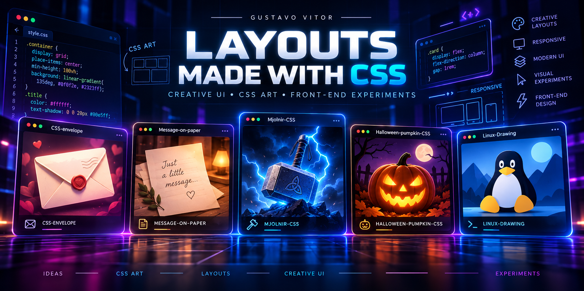

<div align="center">



<br>
<br>

# 🎨 Layouts Made with CSS

### CSS Art • Creative Layouts • Front-End Experiments

A curated collection of visual web experiments created to explore how far **HTML and CSS** can go when code is used as a creative medium.

From an animated envelope and a paper message to Mjölnir, a Halloween pumpkin and Tux, each project has its own visual identity while remaining lightweight and browser-friendly.

<br>


<br>

**5 creative projects • CSS Art • Interactive experiments • GitHub Pages**

</div>

---

## 🚀 Quick Access

| Project | Focus | Repository | Live Demo |
|:--|:--|:--:|:--:|
| 💌 **CSS Envelope** | CSS illustration / interaction | [Repository](https://github.com/GustavoVitorS/CSS-envelope) | [Open Demo](https://gustavovitors.github.io/CSS-envelope/) |
| 📜 **Message on Paper** | Paper-style CSS composition | [Repository](https://github.com/GustavoVitorS/Message-on-paper) | [Open Demo](https://gustavovitors.github.io/Message-on-paper/) |
| ⚡ **Mjölnir CSS** | CSS pseudo-3D / storm effects | [Repository](https://github.com/GustavoVitorS/Mjolnir-CSS) | [Open Demo](https://gustavovitors.github.io/Mjolnir-CSS/) |
| 🎃 **Halloween Pumpkin CSS** | Seasonal CSS art | [Repository](https://github.com/GustavoVitorS/Halloween-pumpkin-CSS) | [Open Demo](https://gustavovitors.github.io/Halloween-pumpkin-CSS/) |
| 🐧 **Linux Drawing** | CSS illustration / interactive learning | [Repository](https://github.com/GustavoVitorS/Linux-Drawing) | [Open Demo](https://gustavovitors.github.io/Linux-Drawing/) |

---

# ✨ Projects

## 💌 CSS Envelope

<div align="center">


<br><br>

[](https://github.com/GustavoVitorS/CSS-envelope)
[](https://gustavovitors.github.io/CSS-envelope/)

</div>

A creative envelope illustration built for the browser, using front-end code to reproduce the look and feeling of a physical message.

### Project focus

- CSS illustration
- Layered shapes
- Envelope composition
- Visual depth
- Lightweight browser experience
- No heavy framework required

---

## 📜 Message on Paper

<div align="center">


<br><br>

[](https://github.com/GustavoVitorS/Message-on-paper)
[](https://gustavovitors.github.io/Message-on-paper/)

</div>

A paper-inspired visual experiment that explores how typography, shadows, spacing and CSS styling can turn a simple message into a more expressive browser composition.

### Project focus

- Paper-inspired layout
- Typography
- CSS shadows and depth
- Visual composition
- Minimal front-end structure
- Creative presentation

---

## ⚡ Mjölnir CSS — Storm-Forged V2

<div align="center">


<br><br>

[](https://github.com/GustavoVitorS/Mjolnir-CSS)
[](https://gustavovitors.github.io/Mjolnir-CSS/)

</div>

A complete evolution of the original Mjölnir CSS experiment. The current version turns the hammer into a lightweight pseudo-3D CSS object and surrounds it with an interactive storm atmosphere.

### Highlights

- CSS pseudo-3D hammer
- `perspective` and `transform-style: preserve-3d`
- Layered forged-metal styling
- Pointer-based parallax
- Animated storm background
- Procedural lightning interaction
- Responsive performance adjustments
- Reduced-motion support

---

## 🎃 Halloween Pumpkin CSS

<div align="center">


<br><br>

[](https://github.com/GustavoVitorS/Halloween-pumpkin-CSS)
[](https://gustavovitors.github.io/Halloween-pumpkin-CSS/)

</div>

A Halloween-themed CSS art experiment centered around the recognizable shape and glow of a carved pumpkin.

### Project focus

- CSS art
- Halloween visual identity
- Layered shapes
- Lighting and glow
- Decorative front-end experimentation
- Static-browser compatibility

---

## 🐧 Linux Drawing — Interactive Linux Academy

<div align="center">


<br><br>

[](https://github.com/GustavoVitorS/Linux-Drawing)
[](https://gustavovitors.github.io/Linux-Drawing/)

</div>

Linux Drawing began as a Tux illustration built with HTML and CSS and later evolved into an interactive Linux learning experience while preserving the original CSS-art identity.

### Highlights

- Tux-inspired CSS illustration
- Interactive mascot behavior
- Responsive interface
- Linux learning sections
- Browser terminal simulation
- Command and distribution exploration
- EN / PT-BR interface
- Keyboard accessibility
- Reduced-motion support
- GitHub Pages compatibility

---

# 🎭 Why This Collection Exists

The projects in **Layouts Made with CSS** were created around a simple idea:

> **Code can also be illustration, composition and visual experimentation.**

Instead of focusing only on conventional website sections, this collection explores subjects that can be recreated, styled or transformed through front-end techniques.

The projects cover:

- illustrated objects;
- decorative layouts;
- CSS shapes;
- gradients;
- pseudo-elements;
- transforms;
- perspective;
- responsive design;
- animation;
- lightweight JavaScript interaction.

---

## 🧱 Techniques Used Across the Collection

<div align="center">

| Technique | Purpose |
|:--|:--|
| **HTML5** | Semantic structure and visual building blocks |
| **CSS3** | Illustration, layout, color and styling |
| **Pseudo-elements** | Extra shapes without unnecessary markup |
| **Gradients** | Lighting, atmosphere and surface detail |
| **Transforms** | Rotation, depth and positioning |
| **Flexbox / Grid** | Responsive composition |
| **CSS Animation** | Motion and visual feedback |
| **Vanilla JavaScript** | Lightweight interaction where useful |
| **GitHub Pages** | Static browser deployment |

</div>

---

## 🎨 Collection Identity

This repository intentionally mixes different visual themes:

**Romantic • Paper • Mythological • Halloween • Linux**

The connection between them is not the subject itself.

The connection is the process:

```text
IDEA
  ↓
HTML STRUCTURE
  ↓
CSS SHAPES
  ↓
COLOR + DEPTH
  ↓
INTERACTION
  ↓
BROWSER ART
```

---

## 📁 Repository Structure

The hub is intentionally kept flat so the files can be uploaded directly through GitHub.

```text
layouts-made-with-css/
├── README.md
├── layouts-made-with-css-banner.png
├── css-envelope-preview.png
├── message-on-paper-preview.png
├── mjolnir-css-preview.png
├── halloween-pumpkin-css-preview.png
└── linux-drawing-preview.png
```

---

## 🖼️ About the Preview Images

The images included in this hub are presentation visuals for the collection.

If you want to replace any of them later with a **real screenshot of the latest deployed version**, keep the same filename and upload the replacement image to the repository root.

The README will update automatically without requiring any code changes.

---

## 🌐 About This Repository

**Layouts Made with CSS** is a central index for my CSS-art and creative front-end projects.

Each experiment keeps its own:

- source repository;
- project history;
- visual identity;
- GitHub Pages deployment.

This repository exists to bring them together in one organized and visual portfolio.

---

<div align="center">

## 👨‍💻 Gustavo Vitor

**CSS Art • Front-End • Creative Coding • Responsive UI**

<br>

[](https://github.com/GustavoVitorS)

<br>

</div>
